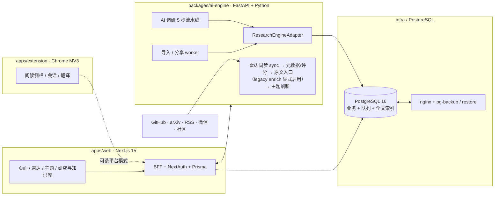

# AI技术调研平台

> AI 帮我们读文章、抓热搜、看趋势；我们给反馈、踩坑记下来，团队的判断和经验会越攒越多。
> 架构基线：[`docs/ARCHITECTURE.md`](./docs/ARCHITECTURE.md) v4.2

[](https://github.com/csbpku/deep_research/actions/workflows/ci.yml)

## 这个项目做什么

一个面向个人和小团队的技术调研与知识沉淀平台。平台从 GitHub、arXiv、RSS、微信公众号、社区和成员提交中发现技术内容，协助阅读、研究、讨论和归档；研究、批注与个人判断可以检索并在后续调研中复用。

**核心能力**

- **技术雷达**：从 GitHub、arXiv、RSS、微信公众号、Hacker News / Product Hunt / Reddit 等社区和成员分享发现候选，并提供评分、筛选、反馈和讨论。默认 `RADAR_READING_MODE=browser` 在同步时临时读取来源正文用于摘要和评分，不持久化全文，也不运行后续 enrichment；`enriched` 是显式兼容/回滚路径。
- **技术专题**：关注长期专题后自动聚合热点议题，生成带可点击引用的综述；发布的调研可回流专题，`/me/topics` 汇总关注专题的未读议题与最近研究。
- **研究与知识库**：AI 调研可生成研究稿、快速判断、Slides 提纲和网页简报；研究稿支持修订、来源与事实审核，满足修改和质量门禁后才能发布。研究稿与知识卡片支持私人草稿、显式发布、全文搜索和修改审计；已有私人知识可由用户选入调研上下文，Reader 笔记及经确认的 AI 判断可保存为私人知识。
- **Chrome Reader 扩展**：`apps/extension/` 提供 WXT、React、TypeScript 和 MUI 构建的 MV3 阅读侧栏。用户可在网页中选段问答、连续追问、整页或选段翻译、解读技术图片，并管理会话、收藏和阅读历史。可连接自行配置的模型服务，也可选用平台模式；读取网页和发送内容由用户操作触发。构建和安装见下文及 [`apps/extension/README.md`](./apps/extension/README.md)。
- **文件导入与成员分享**：上传 `.md / .txt / .html` 可异步转换为私有 Markdown 草稿；成员也可提交网页链接或文件，经安全抓取和审核进入雷达候选。
- **团队讨论 + Admin**：雷达和沉淀支持评论、@成员、回复通知和“我的通知”；成员可提议把高价值评论沉淀为知识卡片。Admin 管理成员、雷达治理、分享审核、专题提案、评论提炼、同步状态、失败任务和 LLM 用量。
- **搜索与分享**：全文检索（PostgreSQL GIN / 触发器）+ 成员对外分享（URL 经 SSRF-safe 抓取 + LLM 摘要后入候选池）。
- **运行底线**：权限、成本埋点、结构化日志、`pg_dump` 备份恢复、Docker Compose 部署脚手架。

文档总入口见 [`docs/README.md`](./docs/README.md)；技术设计说明见 [`docs/ARCHITECTURE.md`](./docs/ARCHITECTURE.md)，按功能验收见 [`docs/FUNCTIONAL_CHECKLIST.md`](./docs/FUNCTIONAL_CHECKLIST.md)，部署见下文。

## 架构总览



- **`apps/web/`** —— Next.js 页面与 BFF：登录、技术雷达、专题、研究与知识库、搜索、文件导入、Reader 平台 API 和管理控制台。
- **`apps/extension/`** —— Chrome Reader 扩展：网页阅读侧栏、本地模型配置、问答与翻译，以及可选的平台连接。
- **`packages/ai-engine/`** —— FastAPI 后台：雷达同步与审核、专题聚合、AI 调研和事实审核、文件导入与分享任务；检索由所选的 gpt-researcher retriever 配置提供。
- **`packages/shared/`** —— TypeScript 与 Python 共用的 schema、错误码和状态契约。
- **`packages/design-system/`** —— Web 与 Reader 共用的设计 token、主题和生成的样式基础。
- **`infra/`** —— `docker-compose.yml` + nginx + 多阶段 Dockerfile + `pg-backup.sh` / `pg-restore.sh` / `import-tmp-cleanup.sh`。

更多见 [`docs/ARCHITECTURE.md`](./docs/ARCHITECTURE.md)。

## 技术栈

### 本地开发服务常驻（macOS）

如果希望关闭终端后仍保持本地 Web 和 AI engine 运行，可安装仓库中的 launchd 模板：

```bash
# 先完成依赖、环境文件、数据库 migration，并生成 production build
./scripts/setup.sh --quick
pnpm --filter @deep-research/web build

mkdir -p ~/Library/LaunchAgents
cp infra/launchd/com.deep-research.web.plist ~/Library/LaunchAgents/
cp infra/launchd/com.deep-research.ai.plist ~/Library/LaunchAgents/
launchctl bootstrap gui/$(id -u) ~/Library/LaunchAgents/com.deep-research.web.plist
launchctl bootstrap gui/$(id -u) ~/Library/LaunchAgents/com.deep-research.ai.plist
```

模板中的 `WorkingDirectory` 和 Node/uv 路径是本机模板值；如果仓库目录、Homebrew 路径或 Python 虚拟环境不同，先修改 plist。launchd Web 使用 `next start`，代码变更后需要重新执行 `pnpm --filter @deep-research/web build`，再重启 Web job。

停止托管服务：

```bash
launchctl bootout gui/$(id -u)/com.deep-research.web
launchctl bootout gui/$(id -u)/com.deep-research.ai
```

launchd 托管的 AI engine 使用稳定模式（不随代码文件自动重启）；需要开发热重载时再单独运行 `pnpm dev:ai`。日志位于 `/tmp/deep-research-web*.log` 和 `/tmp/deep-research-ai*.log`。

彻底停掉本机常驻环境时，还要停止 Homebrew PostgreSQL：

```bash
brew services stop postgresql@16
```

恢复时按 PostgreSQL → AI engine → Web 的顺序执行：

```bash
brew services start postgresql@16
launchctl bootstrap gui/$(id -u) "$HOME/Library/LaunchAgents/com.deep-research.ai.plist"
launchctl bootstrap gui/$(id -u) "$HOME/Library/LaunchAgents/com.deep-research.web.plist"
```

`launchd` 模板的 `KeepAlive=true` 会自动重启子进程；只杀 PID 不等于彻底停止。完整的本地服务生命周期、检查命令和文档分层见 [`docs/TECHNICAL_OVERVIEW.md`](./docs/TECHNICAL_OVERVIEW.md)。

| 层 | 选型 |
|---|---|
| Web / BFF | Next.js 15（App Router）、React 19、TypeScript、MUI、NextAuth、Prisma、Vitest、Playwright |
| Reader 扩展 | Chrome Manifest V3、WXT、React、TypeScript、MUI；可配置兼容模型服务或连接平台 |
| AI / 后台 | Python 3.11、FastAPI、Pydantic、psycopg、`gpt-researcher` 主适配（`fake` 用于测试/快速体验）、uv |
| 共享 UI | `packages/design-system/`：Web 与 Reader 共用的 token、主题和样式基础 |
| 数据库 | PostgreSQL 16 + `pg_trgm` 模糊检索，`tsvector` 全文索引；migration 由 Prisma 管理 |
| 部署 | Docker Compose + nginx 1.27，本地或单 VPS |
| 工具链 | pnpm workspace（10+）、uv、ruff + mypy、tsc、GitHub Actions CI |

外部依赖：按配置使用受支持的 LLM provider 和检索器（Tavily 为可选 retriever）；登录支持邮箱密码，Google OAuth 可选。

## 本地部署

### 前置条件

- 原生模式：Node.js ≥ 20.11、pnpm ≥ 10、Python ≥ 3.11、uv、PostgreSQL 16。
- Docker 模式：Docker Engine 24+ 与 Compose v2；建议至少 2 vCPU / 4 GB RAM。
- 真实 AI：一个受支持 provider 的 API key，以及 Tavily key（或将 `RETRIEVER=duckduckgo`）。只验 UI 可用 `AI_ENGINE_ADAPTER=fake`。
- 邮箱注册由 `AUTH_BETA_MODE` 控制：`0`（默认）开放普通注册，`1` 仅允许 Admin 预创建的账号完成注册（bootstrap Admin 除外）。若需仅白名单注册，应启用 Beta 模式并在 Admin 成员页预创建邮箱；生产环境必须使用 HTTPS。
- Google OAuth（可选）：创建 Web application，并登记 `http://localhost:3000/api/auth/callback/google`。

### 原生启动

```bash
# 1. 克隆仓库
git clone https://github.com/csbpku/deep_research.git
cd deep_research

# 2. 检测环境、安装依赖、生成 env、建库并执行 migration
./scripts/setup.sh

# 不配 AI key / Google OAuth，只验证产品 UI 与流程（可用邀请码激活邮箱密码登录）
./scripts/setup.sh --quick

# 3. 起服务（两个终端）
pnpm dev:web     # → http://localhost:3000
pnpm dev:ai      # → http://localhost:4000
```

安装脚本会在 migration 后自动补齐默认雷达信息源：共 22 个稳定 source 定义，其中一部分默认停用以避免重复或低质量抓取。信息源配置保存在 `radar_sources` 数据表，不依赖 API key；GitHub token、Product Hunt token 只用于增强对应源。这个初始化是幂等的，只创建缺失行，不会覆盖 Admin 在控制台修改过的 `enabled/config`。

容器启动时 Web entrypoint 也会执行同一个默认源 bootstrap，因此 `git clone` + `./scripts/setup.sh`、本地 Docker 和 GHCR/VPS 部署使用同一套初始化逻辑。

首次安装后：

1. setup 会按 `BOOTSTRAP_ADMIN_EMAIL` 创建或提升初始管理员。
2. 登录页可使用邮箱密码注册；`AUTH_BETA_MODE=1` 时，需由 Admin 预先创建普通成员账号。
3. 管理后台地址为 `/admin`。

首次启动或切换分支后，可显式复核数据库与服务：

```bash
pnpm db:deploy
pnpm db:generate
curl -fsS http://localhost:3000/api/healthz
curl -fsS http://localhost:4000/healthz
```

默认 `AUTH_BETA_MODE=0` 开放邮箱密码注册。设置 `AUTH_BETA_MODE=1` 后，只有 Admin 预创建的账号及 bootstrap Admin 可完成首次注册/登录建档；未知邮箱会被拒绝。`AUTH_EMAIL_VERIFICATION=1` 并配置 SMTP 后，邮箱验证码用于密码注册，以及为已存在但没有密码的账号设置密码。旧 `/api/auth/activate` 才使用 `ALLOWED_EMAIL_DOMAINS` 与 `AUTH_INVITE_CODE`。`--quick` 使用 fake adapter，不要求 OAuth 或模型凭证。

未配置 Google OAuth 时，仍可免登录浏览首页、雷达、调研库和主题等界面；提交 AI 调研、评论、关注/收藏、我的内容和管理后台等操作需要登录。`--quick` 使用 fake adapter，AI 调研返回 mock 数据，不产生 API 费用。

选择真实 LLM 时，setup 默认提供 MiniMax 主模型 + DeepSeek fallback 的直连模式；两者使用独立的 API key 和 Base URL。也可以选择本地兼容 proxy：Anthropic-compatible（例如 cc-switch，默认本机端口 `15721`）或 OpenAI-compatible（例如 ais-switch / vibeproxy）。运行时只认三层 canonical 路由：`RESEARCH_LLM`、`UTILITY_LLM`、`FALLBACK_LLM`；旧的 `SMART_LLM` / `FAST_LLM` / `STRATEGIC_LLM` / `BRIEF_LLM` 仅作为 gpt-researcher 兼容镜像。直连模式使用 `MINIMAX_*` / `DEEPSEEK_*` profile，旧的 `ANTHROPIC_*` / `OPENAI_*` 变量继续用于 proxy 和兼容配置。

### 本地 Docker

```bash
cp .env.example .env
# 至少替换 POSTGRES_PASSWORD、NEXTAUTH_SECRET、INTERNAL_SERVICE_TOKEN，
# 再按需配置认证模式、所选 AI provider / retriever；Google OAuth 可选。
docker compose --env-file .env -f infra/docker-compose.yml config --quiet
docker compose --env-file .env -f infra/docker-compose.yml up -d --build
curl -fsS http://localhost:3000/api/healthz      # web
curl -fsS http://localhost:4000/healthz          # ai-engine
docker compose --env-file .env -f infra/docker-compose.yml ps
```

容器启动时 Web entrypoint 自动执行 `prisma migrate deploy`、Admin bootstrap 和默认雷达信息源 bootstrap。PostgreSQL 只绑定 `127.0.0.1:5432`；生产环境不要改成公网监听。完整环境变量清单见 [`.env.example`](./.env.example)。

### Chrome Reader 扩展（本地加载）

先在仓库根目录安装 workspace 依赖，再构建扩展：

```bash
pnpm install
pnpm --filter @deep-research/reader-extension build
```

在 Chrome 打开 `chrome://extensions`，启用开发者模式并选择“加载已解压的扩展程序”，目录选 `apps/extension/.output/chrome-mv3`。打开网页后点击扩展图标；独立模式可在设置中连接兼容的模型服务，平台模式可选连接本平台。模型设置、隐私边界与详细功能见 [`apps/extension/README.md`](./apps/extension/README.md)。

### 验证

```bash
pnpm typecheck
pnpm test                      # workspace 单测（Web、扩展与共享包）
pnpm --filter @deep-research/web exec playwright test --project=chromium   # E2E
cd packages/ai-engine && uv run pytest -q && uv run ruff check . && uv run mypy ai_engine tools
```

## 单 VPS 生产部署

推荐 Ubuntu 24.04 LTS、2 vCPU / 4 GB RAM 起步、独立域名和非 root 运维账号。以下是当前仓库已支持的单机拓扑；高可用、多机数据库和集中监控不在当前范围。

1. DNS：将域名的 `A/AAAA` 记录指向 VPS；先等待解析生效。
2. 主机：安装 Docker Engine/Compose，克隆到 `/opt/deep_research`，只允许 SSH、80、443 入站；不要放行 3000、4000、5432。
3. Secrets：复制 `.env.example` 为 `.env`，权限设为 `600`；用 `openssl rand -hex 32` 分别生成数据库、NextAuth 和内部服务令牌。设置 `NEXTAUTH_URL=https://research.example.com`。如启用 Google OAuth，再登记 `https://research.example.com/api/auth/callback/google`。
4. 配置：按需设置 `AUTH_BETA_MODE`、OAuth、`BOOTSTRAP_ADMIN_EMAIL`、AI provider 与检索凭证；旧激活接口才需要 `ALLOWED_EMAIL_DOMAINS` 与 `AUTH_INVITE_CODE`。`.env` 不提交 Git，不写入镜像。
5. TLS：用 Certbot/acme.sh 签发 `fullchain.pem` 与 `privkey.pem`，放入 `infra/certs/`（私钥 `0600`）；将 Compose 的 nginx mount 从 `infra/nginx.conf` 切换为 `infra/nginx-tls.conf`。证书签发前不要公开登录流量。
6. 启动：先校验配置，再构建启动；检查容器、HTTPS 和两项 health endpoint。

```bash
cd /opt/deep_research
cp .env.example .env
chmod 600 .env
docker compose --env-file .env -f infra/docker-compose.yml config --quiet
docker compose --env-file .env -f infra/docker-compose.yml up -d --build
docker compose --env-file .env -f infra/docker-compose.yml ps
curl -fsS https://research.example.com/healthz
curl -fsS https://research.example.com/ai-healthz
```

部署后必须实际登录一次，确认 Admin 仪表板、雷达同步、文件导入和 AI 调研可用。日志用 `docker compose ... logs --since=30m web ai-engine nginx` 查看。

#### GitHub Actions + GHCR 快速部署

仓库提供 `.github/workflows/deploy.yml`。它在 `CI` 成功后自动构建 Web、AI engine 两个 Linux/amd64 核心镜像，推送带 commit SHA 的不可变 GHCR 标签，再通过 SSH 让 VPS 拉取并启动；VPS 上的 `.env`、数据库卷、证书和日志不会被覆盖。真实浏览器 `render-review` 改为按需启用的 Compose profile，不进入默认发布链路。失败时工作流会尝试恢复上一次记录的镜像 SHA。

首次启用需要在 GitHub `Settings → Environments → production` 配置：

- Secrets：`VPS_HOST`、`VPS_USER`、`VPS_SSH_KEY`、`VPS_KNOWN_HOSTS`
- 如果 GHCR 包保持私有，再加 `GHCR_USERNAME`、`GHCR_READ_TOKEN`
- Variable：`VPS_DEPLOY_PATH`，不填时默认 `/opt/deep_research`

部署用户需要能运行 Docker。建议使用专用非 root 用户和仅用于部署的 SSH key；`VPS_KNOWN_HOSTS` 应保存固定的 SSH 主机指纹，工作流不会关闭 host key 校验。不需要域名也能完成镜像部署。

之后只要把代码推送到 `main`，CI 通过就会自动部署。也可以在 Actions 页面手动运行 `Deploy`。镜像回滚不回滚数据库 schema，新增迁移必须保持向前兼容。

备份、升级和回滚：每天运行 `infra/pg-backup.sh` 并把备份复制到异机/对象存储；定期在隔离库执行 `infra/pg-restore.sh`。升级前先备份；如果需要数据库恢复，使用 `infra/pg-restore.sh`，不要把镜像回滚当成数据库回滚。

## 仓库布局

| 路径 | 作用 |
|---|---|
| `apps/web/` | Next.js 15 Web + BFF + Prisma + Vitest / Playwright |
| `apps/extension/` | WXT / React Chrome MV3 Reader 扩展与浏览器端阅读体验 |
| `packages/ai-engine/` | FastAPI + `gpt-researcher` 适配 + 雷达、调研、审核、导入和分享 workers |
| `packages/shared/` | TypeScript 与 Python 共用的 schema、错误码和状态契约 |
| `packages/design-system/` | Web 与 Reader 共用的设计 token、主题和样式生成器 |
| `infra/` | `docker-compose.yml`、nginx、Dockerfile、`pg-backup.sh`、`pg-restore.sh` |
| `docs/` | 本地开发知识层；从 [`docs/README.md`](./docs/README.md) 进入，当前规范与历史归档分层维护 |
| `scripts/` | 仓库根 helper：`setup.sh`、`cost_extrapolation.py`、`test-local-env.sh` |

## 当前状态

当前技术方案摘要见 [`docs/TECHNICAL_OVERVIEW.md`](./docs/TECHNICAL_OVERVIEW.md)；数据模型、安全边界与部署拓扑见 [`docs/ARCHITECTURE.md`](./docs/ARCHITECTURE.md)。本 README 只维护使用入口，不记录演进过程或内部运行状态。

## 贡献

这是一个个人项目仓库，目前不接受外部 PR。新克隆按 `scripts/setup.sh` 即可起，按 [`docs/ARCHITECTURE.md`](./docs/ARCHITECTURE.md) 约定的架构与数据模型工作。

获授权的开发者与 Bot 统一遵循 [`CONTRIBUTING.md`](./CONTRIBUTING.md)：从最新 `origin/main` 新建短期 `codex/功能名` 分支，推送分支、创建 PR，经 CI 和合并授权后合回 `main`。两台电脑通过 GitHub 同步；`main` 合并会触发生产部署。

## License

UNLICENSED. Personal project.
